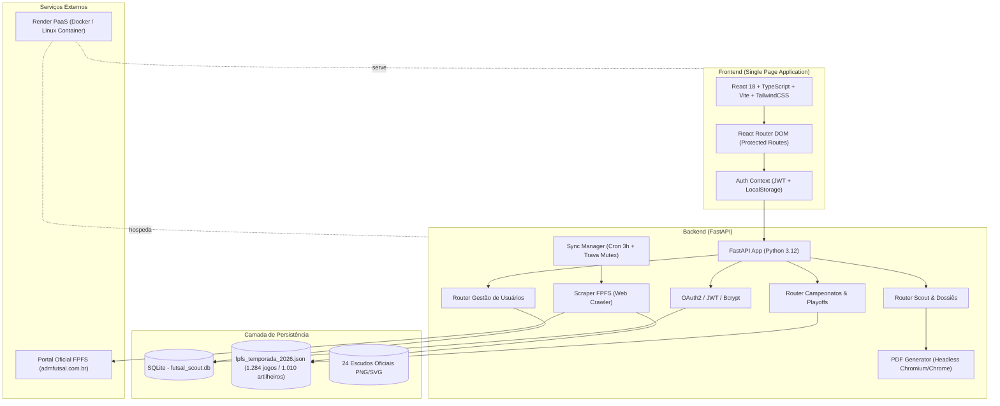

# ⚽ SCOUT FUTSAL INICIAÇÃO — DOCUMENTAÇÃO COMPLETA DA ARQUITETURA E DO SISTEMA

> **Documento Oficial de Engenharia, Regras de Negócio e Funcionalidades**  
> *Versão:* 2.4.0 • *Atualizado em:* Outubro/2026  
> *Destinado a:* Desenvolvedores, Engenheiros de Software, Comissões Técnicas e Modelos de Inteligência Artificial para continuidade e manutenção da aplicação.

---

## 1. VISÃO GERAL E PROPÓSITO DO SISTEMA

O **Scout Futsal Iniciação** é uma plataforma analítica e operacional desenvolvida especificamente para o **Campeonato Paulista de Futsal — Categorias de Iniciação** (organizado pela **Federação Paulista de Futsal - FPFS**).

O campeonato envolve 24 clubes de elite do estado de São Paulo competindo em 4 categorias simultâneas:
- **Sub-7** (Atletas de até 7 anos)
- **Sub-8** (Atletas de até 8 anos)
- **Sub-9** (Atletas de até 9 anos)
- **Sub-10** (Atletas de até 10 anos)

### Principais Objetivos da Solução:
1. **Inteligência Tática Pré-Jogo:** Gerar dossiês comparativos *Head-to-Head* entre clubes, mapeando médias ofensivas/defensivas, aproveitamento Casa x Fora e principais ameaças adversárias (artilheiros).
2. **Sincronização Automatizada com a FPFS:** Robô *web crawler* que monitora o portal oficial da Federação (`admfutsal.com.br`), baixando placares, súmulas em PDF, classificação, pontuações unificadas e artilharia com fotos oficiais dos atletas.
3. **Simulador de Playoffs e Chaveamento Oficial (Mata-Mata):** Cálculo em tempo real do chaveamento das Chaves **Ouro (1º ao 8º)**, **Prata (9º ao 16º)** e **Bronze (17º ao 24º)**, tanto para cada categoria individual quanto para o ranking geral unificado (Torneio União), suportando cruzamentos reais da FPFS e consagrando campeões.
4. **Logística e Comunicação com Famílias:** Mapeamento de ginásios esportivos com rotas no Google Maps/Waze e disparo de convocações formatadas para WhatsApp em um clique.
5. **Fichas Técnicas e Dossiês Executivos em PDF:** Geração de relatórios prontos para impressão com renderização *headless* de alta fidelidade.

---

## 2. ARQUITETURA TÉCNICA DA SOLUÇÃO

A solução é desenhada como uma arquitetura cliente-servidor desacoplada e conteinerizada:



### Stack Tecnológica Detalhada:

| Camada | Tecnologias Utilizadas |
| :--- | :--- |
| **Frontend** | React 18, TypeScript, TailwindCSS, Vite, Lucide Icons, Axios, React Router v6, React Hot Toast |
| **Backend** | Python 3.12, FastAPI, Pydantic v2, SQLAlchemy, Uvicorn, APScheduler |
| **Web Scraping** | BeautifulSoup4, Requests, Urllib3, Regex, Unidecode/Unicodedata para sanitização de mojibake |
| **Geração de PDF** | Headless Google Chrome / Chromium / MS Edge via `--headless --print-to-pdf` |
| **Banco de Dados** | SQLite (`futsal_scout.db`) com migração automática no startup |
| **Container & Cloud** | Docker Multi-stage (Node 20 Alpine + Python 3.12 Slim), Docker Compose, Render PaaS |

---

## 3. MÓDULOS E FUNCIONALIDADES DO SISTEMA

---

### MÓDULO 1: AUTENTICAÇÃO, CONTROLE DE ACESSO E GESTÃO DE USUÁRIOS
- **Páginas:** [`LoginPage.tsx`](file:///c:/Temp/Scout_Futsal_Iniciacao/frontend/src/pages/LoginPage.tsx), [`UserManagementPage.tsx`](file:///c:/Temp/Scout_Futsal_Iniciacao/frontend/src/pages/UserManagementPage.tsx)
- **Backend:** [`auth.py`](file:///c:/Temp/Scout_Futsal_Iniciacao/backend/app/auth.py), [`users.py`](file:///c:/Temp/Scout_Futsal_Iniciacao/backend/app/routers/users.py)
- **Recursos:**
  - Login seguro com email e senha utilizando hash **bcrypt** e tokens de sessão **JWT (Bearer token)** com tempo de expiração configurável.
  - **Dois Níveis de Acesso:**
    - `Administrador`: Acesso total, incluindo gestão de usuários, disparo de sincronizações com a FPFS, atualização de placar ao vivo e correção manual de prorrogações.
    - `Comissão Técnica`: Visualização de dados, análise de scouts, filtros táticos e impressão de relatórios.
  - **Mecanismo "Meu Clube":** Permite vincular a conta do usuário a um clube específico (ex: Pulo Campinas, Palmeiras, Corinthians). Toda a plataforma destaca automaticamente as partidas, posições e dados do clube selecionado.
  - CRUD completo de usuários para o administrador: criação, alteração de clube, redefinição de senhas e desativação.

---

### MÓDULO 2: DASHBOARD INTELIGENTE DA TEMPORADA
- **Página:** [`DashboardPage.tsx`](file:///c:/Temp/Scout_Futsal_Iniciacao/frontend/src/pages/DashboardPage.tsx)
- **Endpoint:** `GET /api/campeonatos/dashboard-resumo`
- **Recursos:**
  - **Cards de KPIs Gerais:** Total de 24 Clubes, 4 Categorias, mais de 1.000 Atletas monitorados, 1.284 Jogos apurados e 100% de súmulas indexadas.
  - **Card do Líder Geral & G4 do Torneio União:** Exibição do líder consolidado da temporada e do quarteto líder com escudos, pontos e aproveitamento.
  - **Zona de Rebaixamento (Z3):** Destaque aos 3 últimos colocados que descem para a Série A2 da Iniciação.
  - **Card Dinâmico "Meu Clube":** Exibe posição atual, chaveamento (Ouro, Prata ou Bronze), índice técnico, saldo de gols, margem de segurança para o Z3, distância para o líder, próximo jogo agendado e as 3 maiores ameaças (artilheiros) do próximo adversário.
  - **Resumo por Categoria:** Abas rápidas para consultar os líderes do Sub-7, Sub-8, Sub-9 e Sub-10.
  - **Top Artilheiros Geral:** Lista dos maiores goleadores de São Paulo com fotos oficiais da Federação e contagem de gols.
  - **Jogos em Destaque:** Lista das partidas mais recentes e próximas partidas com placares e horários.

---

### MÓDULO 3: CAMPEONATOS, CLASSIFICAÇÃO E INTELIGÊNCIA FPFS
- **Página:** [`CampeonatosPage.tsx`](file:///c:/Temp/Scout_Futsal_Iniciacao/frontend/src/pages/CampeonatosPage.tsx)
- **Endpoints:**
  - `GET /api/campeonatos/tabela?temporada=2026&categoria=Sub-X`
  - `GET /api/campeonatos/ranking-eficiencia?temporada=2026`
  - `GET /api/campeonatos/jogos?temporada=2026&categoria=Sub-X`
  - `GET /api/campeonatos/confrontos?temporada=2026`
  - `GET /api/campeonatos/artilharia?temporada=2026&categoria=Sub-X`
  - `POST /api/campeonatos/jogos/atualizar-placar`
  - `POST /api/campeonatos/jogos/corrigir-vencedor`
- **Recursos Principais:**
  - **Classificação por Categoria (Sub-7 a Sub-10):**
    - Exibe Posição, Clube, Escudo, Pontos Ganhos (PG), Jogos (J), Vitórias (V), Empates (E), Derrotas (D), Gols Pró (GP), Gols Contra (GC), Saldo de Gols (SG) e Average (AVG).
  - **Seletor de Visão do Ranking Geral:**
    - **Visão 1: "Oficial FPFS Atualizada":** Tabela consolidada da Federação Paulista computando o Índice Técnico base somado a **Bonificações por Fase Eliminatória** (+300 pontos por fase alcançada em cada categoria) e **Pontos Disciplinares Negativos** (cartões amarelos e vermelhos conforme o Art. 12 do Regulamento).
    - **Visão 2: "1ª Fase Consolidada":** Tabela congelada no término da fase de pontos corridos (23 rodadas), que serviu de base oficial para a divisão das Chaves Ouro (1º-8º), Prata (9º-16º) e Bronze (17º-24º) e chaveamento dos playoffs.
  - **Fórmulas Matemáticas Oficiais da FPFS Aplicadas:**
    $$\text{Índice Técnico (IT)} = \left(\frac{\text{Soma dos Pontos Ganhos}}{\text{Soma dos Jogos Realizados}}\right) \times 1000$$
    $$\text{Average (AVG)} = \frac{\text{Gols Pró}}{\text{Gols Contra}}$$
    $$\text{Total Oficial FPFS} = \text{IT} + \text{Bonificações} - \text{Pontos Negativos}$$
  - **Artilharia Oficial por Categoria:**
    - Lista completa de todos os atletas inscritos com gols anotados.
    - Exibição de foto oficial do atleta hospedada no servidor da Federação.
    - Clube, escudo, quantidade de gols e link direto para a ficha técnica completa.
  - **Jogos e Resultados:**
    - Filtros por Categoria, Rodada e Clube.
    - Link direto para a súmula digitalizada da partida (`sumula_online/sumula_imprimir.php?id_jogo=XXXXX`).
    - Ginásio com botão de localização e mapas.
  - **Painel Administrativo de Atualizações:**
    - Modal de atualização de placar ao vivo (Live Score) para partidas em andamento.
    - Modal de correção manual de prorrogações/pênaltis para empates no mata-mata.
  - **Regulamento Oficial Integrado:**
    - Aba contendo o regulamento completo da FPFS com busca de termos e artigos sobre critérios de desempate, tempo de jogo e regras disciplinares.

---

### MÓDULO 4: PLAYOFFS, MATA-MATA E SIMULADOR INTERATIVO
- **Página:** [`PlayoffsPage.tsx`](file:///c:/Temp/Scout_Futsal_Iniciacao/frontend/src/pages/PlayoffsPage.tsx)
- **Backend:** [`campeonatos.py`](file:///c:/Temp/Scout_Futsal_Iniciacao/backend/app/routers/campeonatos.py#L640-L950)
- **Endpoint:** `GET /api/campeonatos/playoffs?temporada=2026`
- **Recursos Principais:**
  - **Divisão em 3 Chaves:**
    - **Chave Ouro:** 1º ao 8º colocados
    - **Chave Prata:** 9º ao 16º colocados
    - **Chave Bronze:** 17º ao 24º colocados
  - **Estrutura das Fases Eliminatórias:**
    - **Quartas de Final (Jogo Único):**
      - QF1: 1º x 8º
      - QF2: 2º x 7º
      - QF3: 3º x 6º
      - QF4: 4º x 5º
    - **Semifinais:**
      - Pareamento inteligente com as partidas reais marcadas pela FPFS (respeitando o cruzamento olímpico da federação).
    - **Grande Final:**
      - Pareamento com as finais oficiais e consagração do Campeão.
  - **Resolução de Empates e Critério de Desempate:**
    - Se a partida terminar empatada no tempo regulamentar, o sistema verifica primeiro se há vencedor anotado em prorrogação/pênaltis no banco de dados.
    - Caso não haja prorrogação anotada, aplica o critério do Regulamento FPFS: a equipe de melhor campanha na 1ª fase (mandante) tem a vantagem do empate e avança de fase.
  - **Algoritmo de Desambiguação de Clubes em 3 Níveis:**
    - Previne erros entre equipes de nomes similares (ex: *Liga São Caetano* vs *São Caetano / RSFC*).
    - Prioridade 1: Igualdade exata da string normalizada sem acentos.
    - Prioridade 2: Substring contida de forma integral.
    - Prioridade 3: Palavras-chave relevantes com comprimento superior a 3 caracteres.
  - **Simulador Interativo da 23ª Rodada:**
    - Permite ao treinador simular vitórias, empates e derrotas nos confrontos da última rodada da 1ª fase.
    - O sistema recalcula em tempo real no cliente as pontuações, a ordem de classificação geral e remonta todo o bracket dos playoffs instantaneamente.
  - **Simulador Interativo de Mata-Mata:**
    - Clique em qualquer time para avançá-lo manualmente no chaveamento e simular cenários futuros.
    - Botão de reset rápido para restaurar o chaveamento oficial da FPFS.

---

### MÓDULO 5: SCOUT PRÉ-JOGO, DOSSIÊ TÁTICO E LOGÍSTICA
- **Página:** [`ScoutPage.tsx`](file:///c:/Temp/Scout_Futsal_Iniciacao/frontend/src/pages/ScoutPage.tsx)
- **Backend:** [`scout.py`](file:///c:/Temp/Scout_Futsal_Iniciacao/backend/app/routers/scout.py), [`pdf_generator.py`](file:///c:/Temp/Scout_Futsal_Iniciacao/backend/app/services/pdf_generator.py)
- **Endpoints:**
  - `GET /api/scout/clubes`
  - `GET /api/scout/partidas-rodada`
  - `GET /api/scout/confronto?mandante=X&visitante=Y&temporada=2026&categoria=Z`
  - `GET /api/scout/confronto/pdf`
- **Recursos Principais:**
  - **Comparativo Tático Direto (Head-to-Head):**
    - Escolha de dois clubes quaisquer ou seleção rápida a partir dos confrontos agendados na rodada.
    - Comparação lado a lado: Pontos, Posição, Índice Técnico, Vitórias, Empates, Derrotas, Gols Marcados e Sofridos.
    - **Fator Mando:** Aproveitamento do Mandante jogando em Casa versus aproveitamento do Visitante jogando Fora.
    - **Histórico Direto:** Confrontos anteriores disputados entre as duas equipes na temporada em todas as categorias.
  - **Radar de Ameaças Adversárias (Top Artilheiros):**
    - Identifica os maiores goleadores da equipe adversária com foto oficial, média de gols por jogo e percentual de participação nos gols do time.
  - **Módulo de Logística de Ginásios & WhatsApp:**
    - Limpeza e identificação padronizada do ginásio (ex: *Presidente Ciro II*, *Ginásio do Pulo*, *Palestra Itália*).
    - Modal interativo com endereço completo e links diretos para navegação no **Google Maps** e **Waze**.
    - **Botão "Compartilhar no WhatsApp":** Cria automaticamente uma mensagem profissional pronta com data, horário, ginásio, link de mapas e aviso de pontualidade para envio aos grupos de pais e comissão técnica.
  - **Geração de Dossiê Executivo em PDF:**
    - Relatório visual em formato A4 contendo todos os dados táticos, escudos em alta resolução, histórico e alertas para impressão pré-jogo.

---

### MÓDULO 6: FICHA TÉCNICA COMPLETA DO ATLETA
- **Componente:** [`AtletaModal.tsx`](file:///c:/Temp/Scout_Futsal_Iniciacao/frontend/src/components/AtletaModal.tsx)
- **Backend:** [`campeonatos.py`](file:///c:/Temp/Scout_Futsal_Iniciacao/backend/app/routers/campeonatos.py#L284-L380)
- **Endpoints:**
  - `GET /api/campeonatos/atleta?temporada=2026&categoria=Sub-X&id_jogador=YYYY`
  - `GET /api/campeonatos/atleta/pdf`
- **Recursos:**
  - Foto oficial do atleta cadastrada na Federação.
  - Nome completo, clube, categoria e posição no ranking de artilharia.
  - Total de gols, partidas jogadas e média de gols/jogo.
  - **Distribuição Casa x Fora:** Gols marcados dentro de casa contra gols como visitante.
  - **Maiores Vítimas:** Gráfico e contagem dos clubes que mais sofreram gols do atleta.
  - **Histórico Jogo a Jogo:** Tabela com todas as partidas em que o atleta marcou, com data, adversário, placar e link da súmula oficial.
  - Exportação individual da ficha técnica em PDF.

---

### MÓDULO 7: ROBÔ DE SINCRONIZAÇÃO E WEB CRAWLER FPFS
- **Arquivos:** [`scraper_fpfs.py`](file:///c:/Temp/Scout_Futsal_Iniciacao/backend/app/services/scraper_fpfs.py), [`sync_manager.py`](file:///c:/Temp/Scout_Futsal_Iniciacao/backend/app/services/sync_manager.py)
- **Endpoints:**
  - `GET /api/campeonatos/sync-status`
  - `POST /api/campeonatos/sincronizar` (Exclusivo Administrador)
- **Recursos:**
  - **Web Crawler Especializado:** Faz a varredura das páginas da Federação Paulista de Futsal (`admfutsal.com.br`) estruturando:
    - 4 Categorias (Sub-7 a Sub-10)
    - 24 Clubes
    - 1.284 Jogos apurados e futuros
    - Mais de 1.000 artilheiros com fotos
    - Ranking oficial consolidado do Torneio União (incluindo bonificações e pontuação disciplinar)
  - **Trava Mutex Anti-Concorrência:** Impede que múltiplas requisições iniciem scrapes paralelos, protegendo a integridade da base e evitando sobrecarga nos servidores da federação.
  - **Agendamento Cron Automático:** O sistema executa a varredura a cada 3 horas. No startup da aplicação, se o cache local tiver mais de 2 horas de idade, uma sincronização em background é disparada automaticamente.
  - **Tratamento de Codificação (Mojibake):** Filtro decodificador que reverte automaticamente artefatos de encoding UTF-8 / Windows-1252 (ex: converte `S?O PAULO` e `São Paulo` de volta para `São Paulo`).
  - **Resolver Canônico de Escudos:** Dicionário com mapeamento e download dos 24 escudos oficiais em PNG transparente localizados em `/public/escudos/`.

---

## 4. MAPEAMENTO DE DADOS E ARQUIVOS PRINCIPAIS

### 1. Banco de Dados SQLite (`backend/futsal_scout.db`)
Contém as tabelas de gerenciamento operacional e segurança:
- `usuarios`: ID, nome, email, senha_hash, perfil (`administrador` ou `comissao_tecnica`), clube_ativo, ativo, data_criacao.
- `partidas_scout`: Registros de partidas analisadas internamente pela comissão.
- `eventos_scout`: Eventos táticos (finalizações certas/erradas, faltas, defesas, desarmes, cartões).
- `atletas_scout`: Cadastros internos de atletas do clube.

### 2. Base de Dados da Federação (`backend/data/fpfs_temporada_2026.json`)
Arquivo de alta performance em formato JSON consolidado:
- `temporada`: 2026
- `atualizado_em`: Timestamp ISO da última sincronização
- `classificacao`: Dicionário com chaves `Sub-7`, `Sub-8`, `Sub-9`, `Sub-10`
- `ranking_eficiencia`: Lista dos 24 clubes com pontuação oficial consolidada FPFS (com bonificações e cartões)
- `ranking_fase1`: Lista dos 24 clubes com a pontuação congelada da 1ª fase (base para divisão das chaves)
- `jogos`: Dicionário com chaves `Sub-7`, `Sub-8`, `Sub-9`, `Sub-10` (contendo todas as 23 rodadas, quartas, semis e finais)
- `artilharia`: Dicionário com chaves `Sub-7`, `Sub-8`, `Sub-9`, `Sub-10` com fotos e contagem de gols

### 3. Escudos dos 24 Clubes Oficiais (`frontend/public/escudos/`)
Todos os 24 clubes participantes possuem escudos padronizados:
`palmeiras.png`, `s_o_paulo.png`, `corinthians.png`, `santos.png`, `juventus.png`, `batebola.png`, `rsfc.png`, `pulo_futsal.png`, `camisa_10.png`, `mesc.png`, `liga_s_o_caetano.png`, `lausanne_paulista.png`, `c13.png` (Olé Brasil), `uni_o_rd.png`, `bola_no_p_.png`, `portuguesa.png`, `olimpik.png`, `ca_ypiranga.png`, `audax.png`, `taubat_.png`, `hortol_ndia.png`, `tabuca_juniors.png`, `indaiatuba.png`, `magnus.png`.

---

## 5. DICIONÁRIO DE ENDPOINTS DA API REST (FASTAPI)

| Método | Rota | Descrição | Acesso |
| :---: | :--- | :--- | :---: |
| `POST` | `/api/auth/login` | Autentica usuário e retorna JWT token | Público |
| `GET` | `/api/auth/me` | Retorna dados do usuário autenticado | Autenticado |
| `GET` | `/api/users/` | Lista usuários cadastrados | Admin |
| `POST` | `/api/users/` | Cria novo usuário | Admin |
| `PUT` | `/api/users/{id}` | Edita usuário | Admin |
| `DELETE` | `/api/users/{id}` | Desativa usuário | Admin |
| `GET` | `/api/campeonatos/temporadas` | Lista temporadas disponíveis (ex: 2026) | Autenticado |
| `GET` | `/api/campeonatos/categorias` | Lista categorias (Sub-7 a Sub-10) | Autenticado |
| `GET` | `/api/campeonatos/tabela` | Retorna tabela de classificação da categoria | Autenticado |
| `GET` | `/api/campeonatos/ranking-eficiencia`| Retorna ranking unificado do Torneio União | Autenticado |
| `GET` | `/api/campeonatos/jogos` | Retorna lista de partidas da categoria | Autenticado |
| `GET` | `/api/campeonatos/confrontos` | Retorna confrontos agregados da rodada | Autenticado |
| `GET` | `/api/campeonatos/artilharia` | Retorna artilharia oficial com fotos | Autenticado |
| `GET` | `/api/campeonatos/atleta` | Ficha técnica detalhada do atleta | Autenticado |
| `GET` | `/api/campeonatos/atleta/pdf` | PDF da ficha técnica do atleta | Autenticado |
| `GET` | `/api/campeonatos/dashboard-resumo` | KPIs, G4, Z3 e dados do "Meu Clube" | Autenticado |
| `GET` | `/api/campeonatos/playoffs` | Chaveamento completo Ouro/Prata/Bronze | Autenticado |
| `POST` | `/api/campeonatos/jogos/atualizar-placar` | Atualiza placar em tempo real | Admin |
| `POST` | `/api/campeonatos/jogos/corrigir-vencedor`| Registra vencedor de prorrogação/pênaltis | Admin |
| `GET` | `/api/campeonatos/sync-status` | Status do robô de sincronização | Autenticado |
| `POST` | `/api/campeonatos/sincronizar` | Dispara varredura imediata na FPFS | Admin |
| `GET` | `/api/scout/clubes` | Lista clubes para comparativo tático | Autenticado |
| `GET` | `/api/scout/partidas-rodada` | Jogos agendados para preenchimento rápido | Autenticado |
| `GET` | `/api/scout/confronto` | Análise Head-to-Head pré-jogo | Autenticado |
| `GET` | `/api/scout/confronto/pdf` | Dossiê pré-jogo completo em PDF | Autenticado |

---

## 6. INSTRUÇÕES PARA EXECUÇÃO, DEPLOY E MANUTENÇÃO

### Execução Local (Ambiente de Desenvolvimento no Windows):
1. Execute o arquivo na raiz:
   ```cmd
   start_dev.bat
   ```
2. O script inicializará:
   - **Backend:** `http://localhost:8000` (Documentação Swagger: `http://localhost:8000/docs`)
   - **Frontend:** `http://localhost:5173`

### Execução com Docker (Ambiente Conteinerizado):
```bash
docker compose up -d --build
```
Acesse a aplicação unificada na porta configurada (geralmente `http://localhost:80` ou `http://localhost:10000`).

### Deploy em Produção (Nuvem / Render):
- A aplicação utiliza `render.yaml` na raiz com deploy automático ligado à branch `main` do repositório `https://github.com/cmjulio11/scout-futsal.git`.
- Toda alteração enviada com `git push origin main` dispara automaticamente a compilação do Dockerfile multi-stage no Render.
- O Dockerfile instala o navegador Chromium headless no Linux para geração estável de relatórios em PDF.

---

## 7. NOTAS E DIRETRIZES PARA FUTURAS IAs OU DESENVOLVEDORES

1. **Desambiguação de Clubes:**
   - Nunca utilize apenas `clube in string` de forma simples. Clubes como *São Caetano / RSFC* e *Liga São Caetano* compartilham termos. Sempre respeite a prioridade: igualdade exata $\rightarrow$ substring completa $\rightarrow$ palavras-chave isoladas com mais de 3 letras.
2. **Critérios de Mata-Mata:**
   - Na Iniciação da FPFS, os jogos de mata-mata que terminam empatados no tempo normal vão para a prorrogação. Se a prorrogação terminar empatada, a equipe mandante (de melhor campanha geral na 1ª fase) avança por ter a vantagem do empate.
3. **Persistência de Dados e Cache:**
   - O arquivo `backend/data/fpfs_temporada_2026.json` funciona como cache estruturado resiliente. Caso o site da FPFS fique temporariamente fora do ar ou bloqueie requisições, o backend serve imediatamente os dados em cache com zero downtime para o usuário.
4. **Formatação de Textos e Ginásios:**
   - As funções utilitárias em `frontend/src/utils/ginasios.ts` e `backend/app/services/scraper_fpfs.py` limpam prefixos numéricos de relatórios e padronizam nomes para busca nos mapas.
